# Guia de Suporte — Manutenção Tri Hotéis

Este guia é para quem **atende dúvidas e problemas** dos usuários do sistema: gerentes, o administrador e a equipe de TI. Ele diz o que perguntar, quem resolve cada coisa e como resolver os problemas mais comuns. Endereço do sistema: https://hotpink-butterfly-390092.hostingersite.com

---

## 1. Como atender: o que coletar antes de resolver

Peça sempre estas informações. Com elas, a maioria dos problemas se resolve na primeira conversa.

| Pergunte | Por quê |
| --- | --- |
| Qual é o **nome de usuário** (não a senha) e o **hotel**? | Mostra o perfil e o escopo de acesso |
| Qual é o **perfil** (governanta, técnico, gerente, diretoria, administrador)? | Cada perfil vê e faz coisas diferentes |
| Em que **aparelho e navegador** (ex.: iPhone/Safari, Android/Chrome, PC/Edge)? O app está **instalado** na tela inicial? | Notificações e modo offline dependem disso |
| Qual **mensagem apareceu**, exatamente? Pode mandar um **print**? | A mensagem costuma indicar a causa (ver seção 11) |
| **Em que tela** estava e **o que clicou**? | Permite reproduzir |
| **Quando** aconteceu (dia e hora)? Estava **sem internet**? | O registro de acessos e de ações mostra o que ocorreu |

**Nunca peça a senha da pessoa.** Para trocar uma senha, defina uma senha provisória (seção 3).

> **Como ler os prints deste guia:** as caixas e setas vermelhas mostram **onde olhar ou clicar**, e o texto no rótulo explica o que cada ponto significa. As telas são de uma cópia de demonstração, com dados fictícios.

---

## 2. Quem resolve o quê

| Nível | Quem | Resolve |
| --- | --- | --- |
| 1 | **Gerente do hotel** | Usuários e senhas da equipe do hotel, redefinir duas etapas da equipe, checklist do hotel, quartos, ligar/desligar relato pelo QR, orientar a equipe |
| 2 | **Administrador geral** | Tudo do nível 1 em qualquer hotel, usuários de rede (diretoria e administradores), limite de aprovação e orçamento dos hotéis, importação de quartos do HITS, backups, auditoria da rede |
| 3 | **TI / quem mantém o servidor** | Servidor da Hostinger, publicação de versões, restauração de backup, variáveis de ambiente, falhas que o administrador não consegue resolver |

**Regra prática:** comece no nível 1. Só suba quando o problema exigir permissão que o nível anterior não tem, ou quando houver erro do sistema (mensagem "Erro interno do servidor" ou tela travada que se repete).

---

## 3. Acesso e login

| Situação | Causa provável | O que fazer |
| --- | --- | --- |
| "Usuário ou senha inválidos" | Senha ou usuário digitado errado. O usuário **não diferencia maiúsculas** e ignora espaços nas pontas; a senha diferencia | Peça para tocar no ícone do olho e conferir a senha. Se persistir, o gerente define uma **senha provisória** |
| "Muitas tentativas de login. Aguarde 15 minutos." | 10 erros seguidos do mesmo endereço (IP) | Aguardar 15 minutos. Não adianta trocar de usuário no mesmo aparelho. A tentativa aparece em **Registro de ações → Acessos** |
| Entra e pede "Defina uma nova senha" | Senha provisória: é obrigatório trocar no primeiro acesso | Orientar a criar uma senha própria (mínimo de 8 caracteres) |
| Esqueceu a senha | — | Gerente (ou administrador) em **Equipe e cadastros** → **Redefinir senha** da pessoa. A senha vira provisória e as sessões dela são encerradas |
| Usuário não consegue entrar mesmo com a senha certa | Conta **desativada** ou **excluída** | Gerente/administrador confere em **Equipe e cadastros** e usa **Reativar** |
| Pede "Código de verificação" | A conta tem **verificação em duas etapas** | Digitar o código de 6 dígitos do aplicativo autenticador (muda a cada 30 segundos) |
| "Código de verificação incorreto" | Horário do celular errado, ou código já usado | Ajustar data e hora do celular para automático. Esperar o próximo código (o mesmo código não vale duas vezes) |
| Perdeu o celular do autenticador | — | Usar um dos **8 códigos de recuperação** (cada um vale uma vez). Sem eles: gerente (equipe do hotel) ou administrador usa **Redefinir 2 etapas**. Para o próprio administrador sem códigos, é necessário o nível 3 |
| "Sessão expirada. Faça login novamente." | A sessão dura 12 horas | Entrar de novo |
| Ao escanear o QR da porta aparece um formulário, não o login | O relato pelo QR (sem login) está ligado no hotel | Normal. A equipe usa o link **entrar no sistema** no rodapé do formulário |

**Redefinir a senha de alguém:** Equipe e cadastros → linha do usuário → **Redefinir senha** → digitar uma senha provisória de pelo menos 8 caracteres → informar a pessoa por um canal seguro.

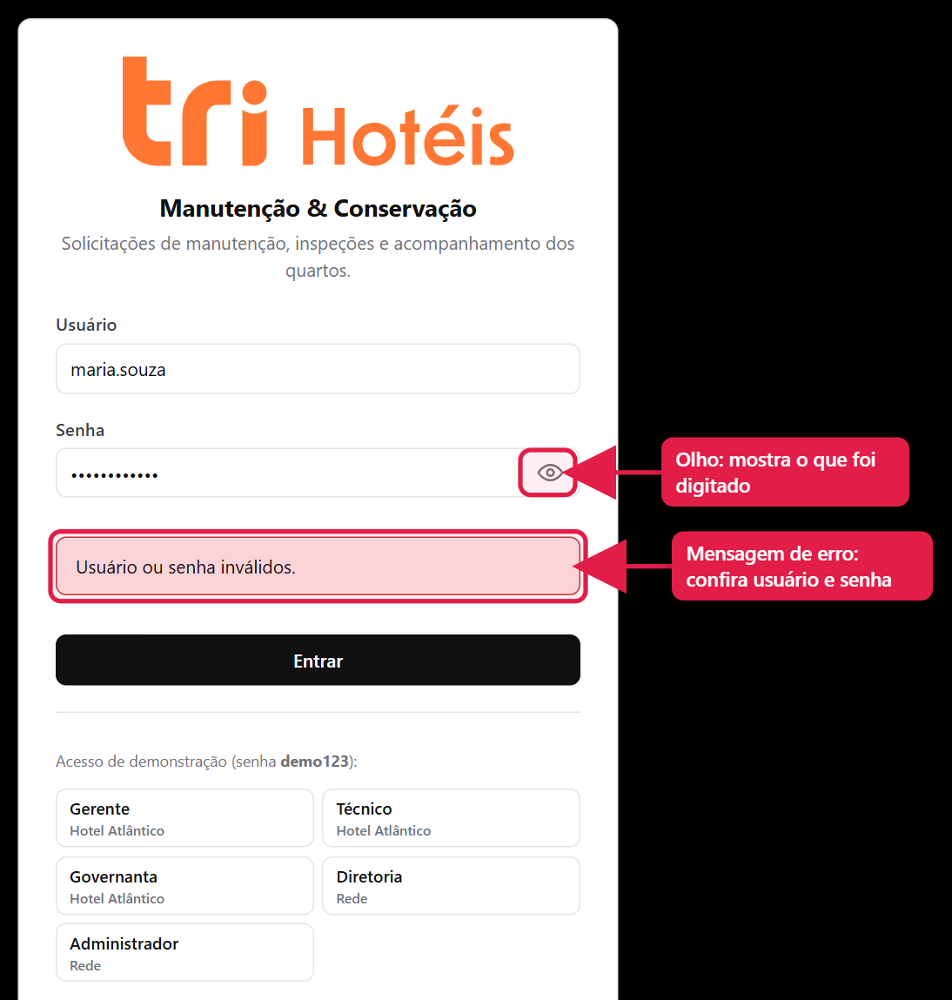

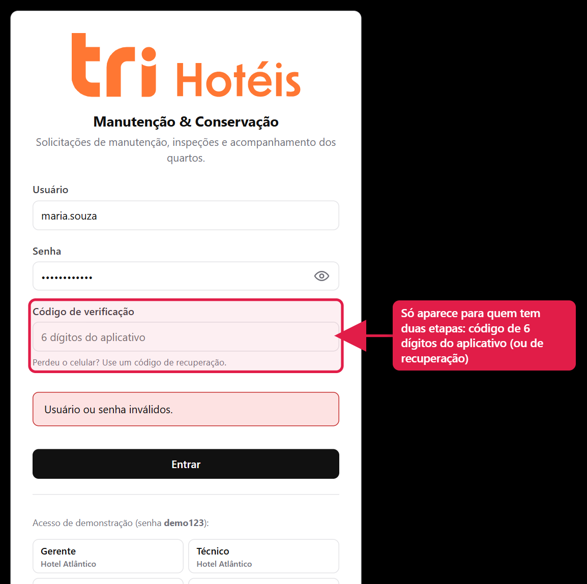

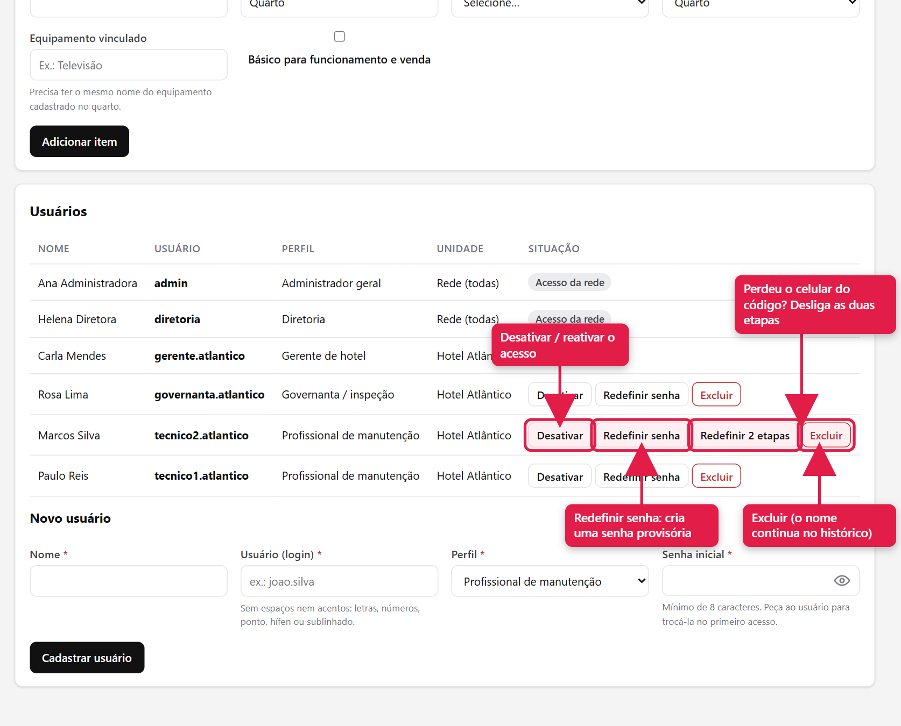

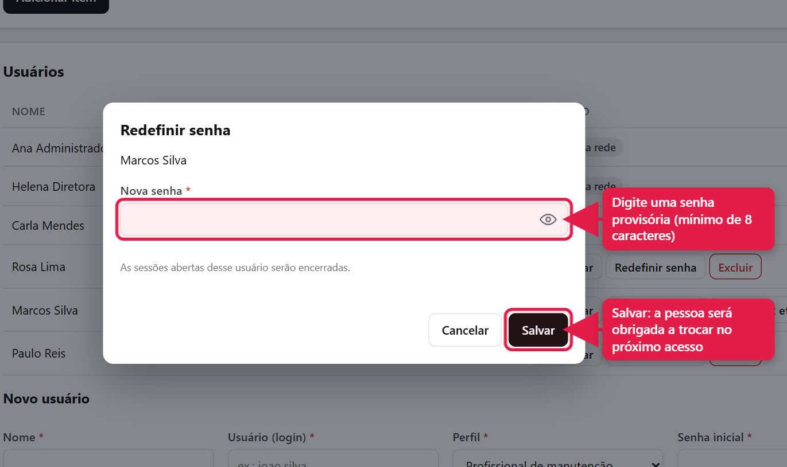

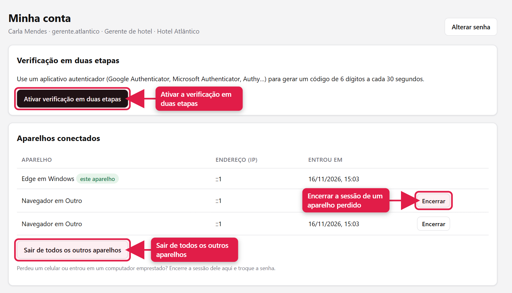

---

## 4. "Não vejo o menu / o botão"

O menu muda conforme o perfil. A tabela abaixo ajuda a saber se é falta de permissão (normal) ou problema.

| Módulo | Quem vê |
| --- | --- |
| Nova solicitação | Gerente, governanta, administrador |
| Inspeções | Gerente, governanta, administrador |
| Preventiva, Estoque | Gerente, administrador |
| Obrigações legais | Gerente, administrador (diretoria só consulta) |
| Indicadores, Recorrência | Gerente, diretoria, administrador |
| Visão da rede | Diretoria, administrador |
| Equipe e cadastros / Cadastros | Gerente (só o hotel dele), administrador |
| Registro de ações | Gerente (só o hotel dele), diretoria, administrador |
| Backups, importar quartos | Somente administrador |
| Meus serviços, Envios pendentes | Técnico |

**Cada pessoa só enxerga o próprio hotel**, exceto diretoria e administradores. Se um gerente "não vê" um quarto ou uma OS, confirme se ela é do hotel dele.

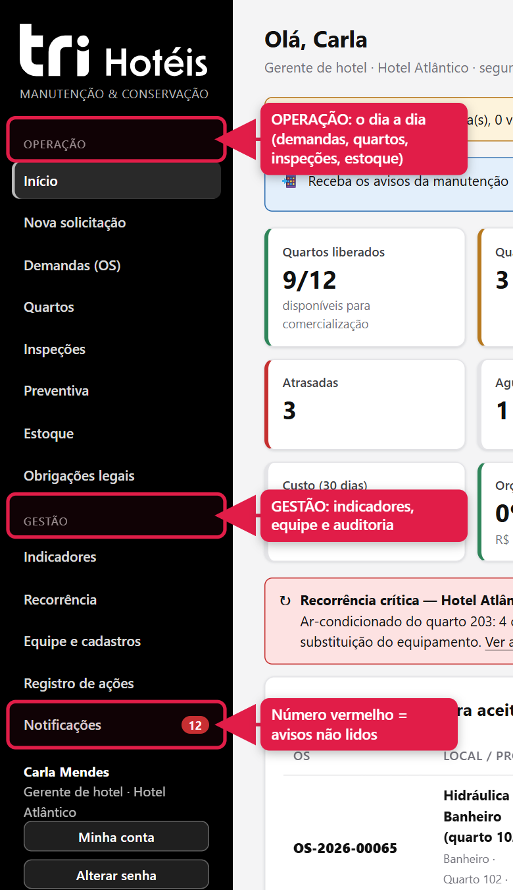

---

## 5. Demandas (ordens de serviço)

| Situação | Explicação e solução |
| --- | --- |
| "Ação ... não permitida para seu perfil no status atual" | Os botões dependem da **situação** da demanda e do **perfil**. Atualize a página e veja quais botões aparecem. Outra pessoa pode ter tratado a demanda antes |
| Técnico não vê a demanda | Ela não foi **designada** a ele, ou está em outro hotel. O gerente usa **Aceitar e designar técnico**. Só aparecem técnicos do mesmo hotel |
| Gerente não consegue autorizar orçamento | O valor passou do **limite de aprovação do hotel**. Acima dele, só **diretoria ou administrador** autorizam. O limite é definido pelo administrador em Cadastros ("Gerente aprova até") |
| Técnico não consegue registrar a conclusão | A **foto do serviço concluído é obrigatória**, assim como a descrição do que foi feito |
| Demanda concluída "não encerra" | Fica aguardando a **validação** do gerente (ou de quem abriu). Use **Aprovar serviço** ou **Solicitar correção** |
| Quarto continua bloqueado depois do serviço | Ao validar, deixe marcado **Liberar o quarto**. Também dá para liberar na ficha do quarto |
| Demanda aparece como atrasada | O prazo vence conforme a prioridade (emergencial 4 h, alta 24 h, média 72 h, baixa 7 dias, salvo prazo informado). O gerente pode usar **Definir prazo** |
| Abri a OS errada | **Cancelar solicitação** (enquanto ainda não entrou em execução) |
| A OS foi devolvida | Quem abriu precisa **Enviar complementação** com a informação pedida |

**Diretoria e administração são avisadas** quando um atraso passa do limite: emergencial 2 h, alta 12 h, média 24 h, baixa 48 h depois do vencimento.

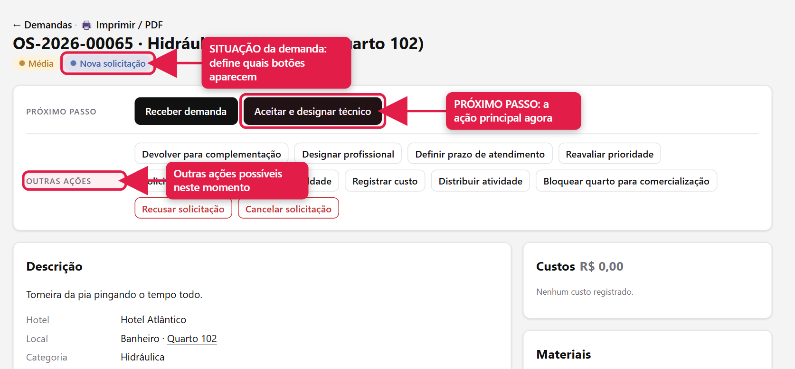

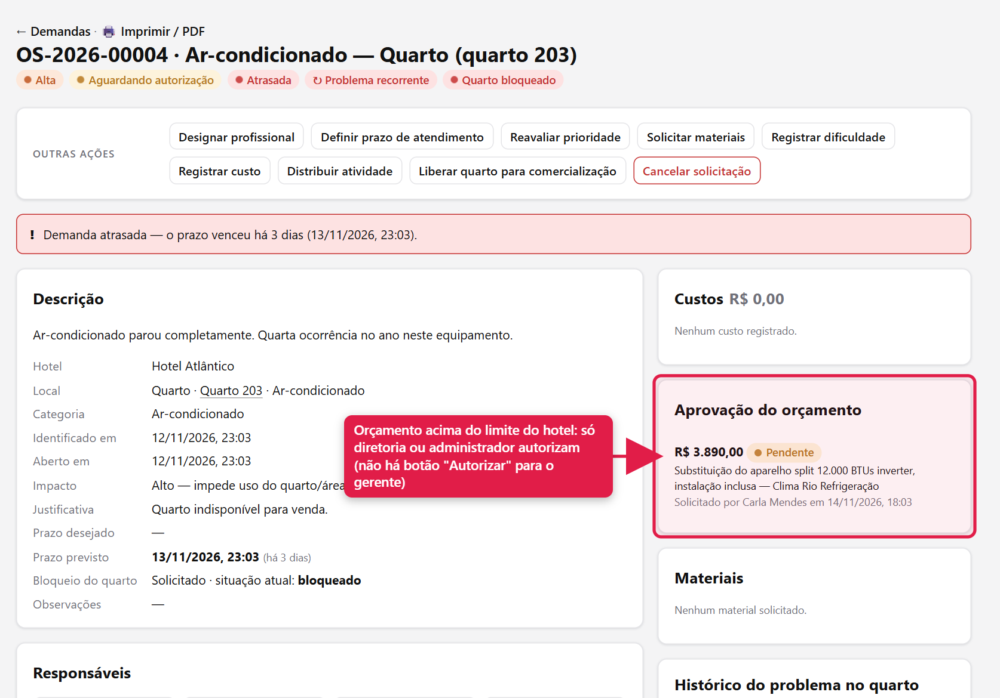

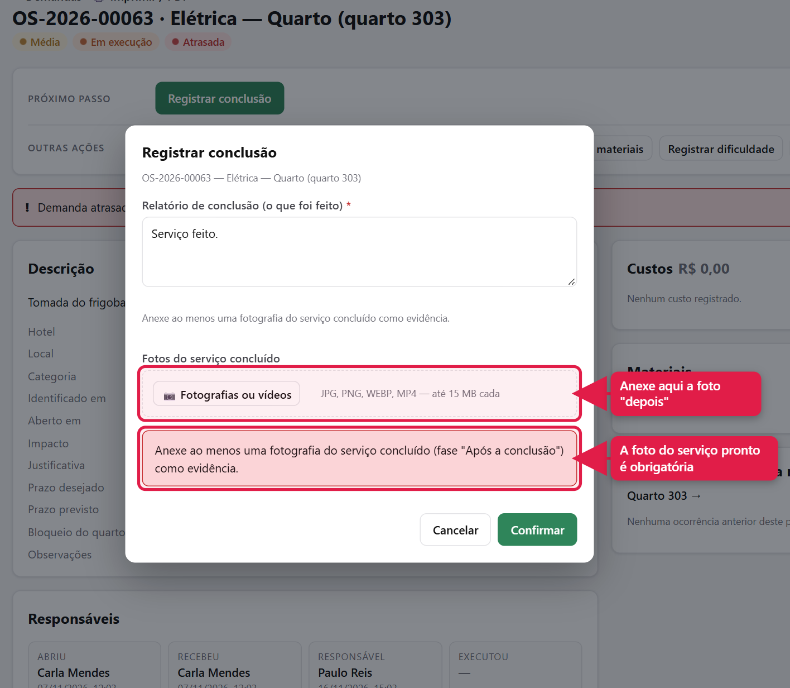

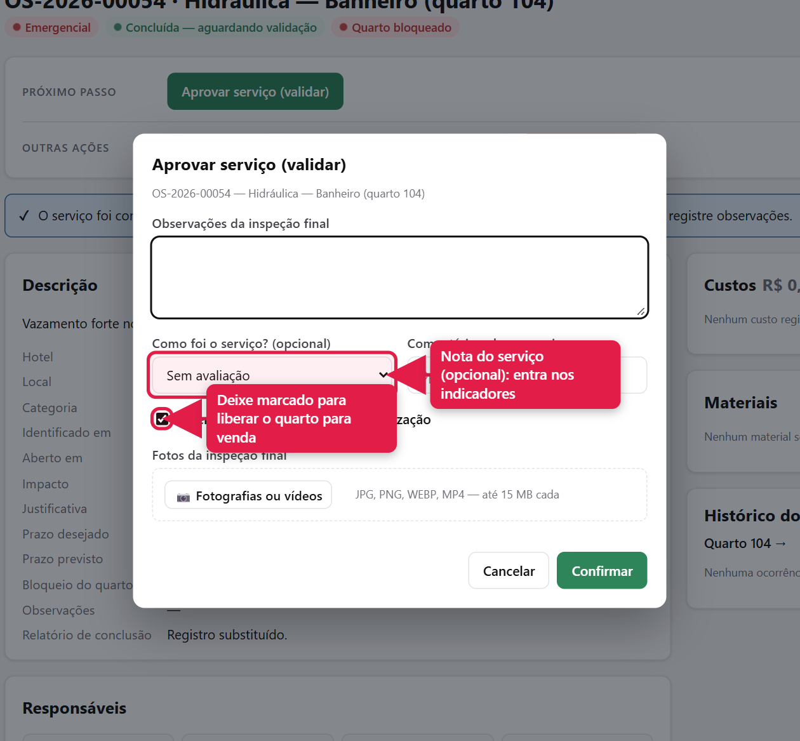

---

## 6. Inspeções, quartos e QR code

| Situação | Explicação e solução |
| --- | --- |
| "O checklist deste hotel está vazio" | Todos os itens foram desativados ou excluídos. O gerente adiciona ou reativa itens em **Equipe e cadastros → Checklist** |
| Não consigo concluir a inspeção | É preciso responder **todos os itens**. A faixa no topo mostra quantos faltam |
| Inspeção sem internet | As respostas ficam guardadas no aparelho e são enviadas depois. Peça para não fechar a inspeção antes de a conexão voltar |
| Alteração no checklist de um hotel "mexeu" em outro | Não acontece: cada hotel tem o próprio checklist |
| QR code abre "Página não encontrada" | App antigo guardado no celular. Fechar e abrir o app, ou limpar os dados do site. O endereço da etiqueta é `…/q/<número>` |
| Etiquetas com número errado depois da importação de quartos | A importação troca os quartos provisórios pelos reais. **Reimprima as etiquetas** em Quartos → QR codes |
| QR code não lê | Etiqueta pequena ou suja. Imprimir no tamanho Médio ou Grande |

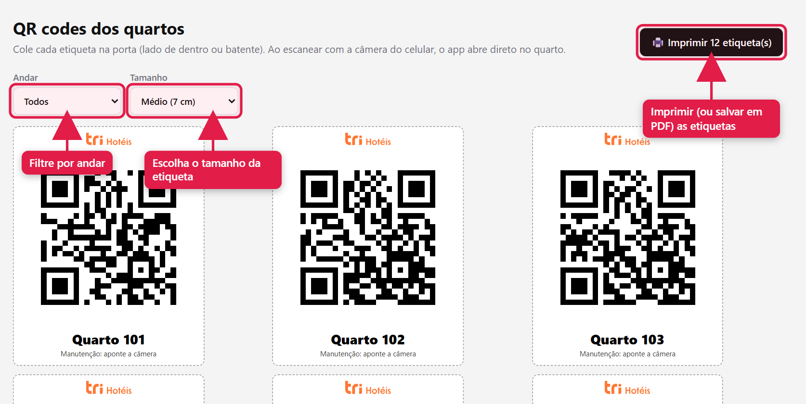

**Relato pelo QR (sem login):** vem **desligado**. O gerente liga em Equipe e cadastros (administrador liga por hotel em Cadastros). Mensagens comuns:
- "O relato pelo QR code não está ativo neste hotel": está desligado.
- "Muitos relatos enviados deste aparelho": limite de 5 por hora por aparelho.
- "Já recebemos vários relatos deste quarto hoje": limite de 6 por dia por quarto.
- Nenhum deles cria uma demanda emergencial. O texto do formulário orienta ligar para a recepção em casos urgentes.

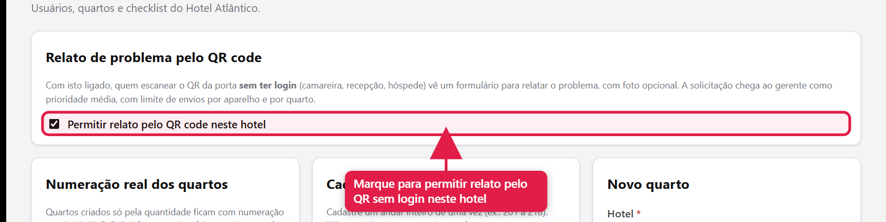

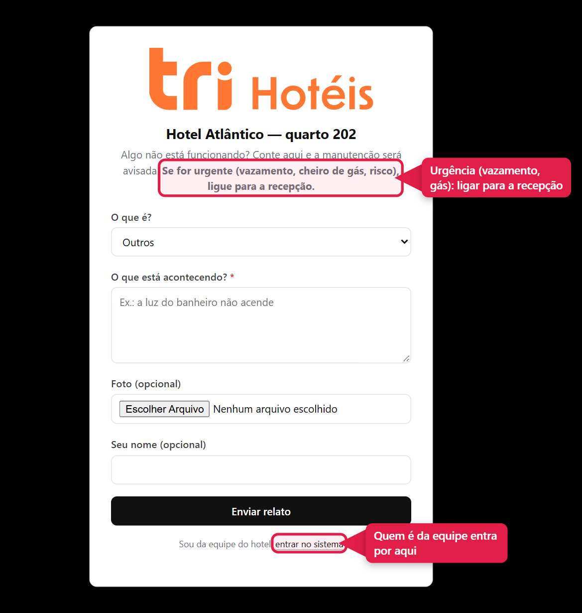

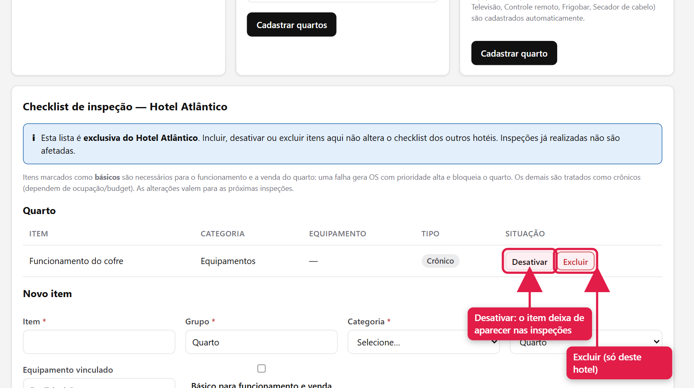

---

## 7. Técnico sem internet (modo offline)

Como funciona: ao abrir o app **com internet**, as demandas do técnico ficam guardadas no aparelho. Sem sinal, ele continua consultando e registrando ações; elas entram numa fila e são **enviadas sozinhas** quando a internet volta.

| Situação | Explicação e solução |
| --- | --- |
| Faixa amarela "Sem conexão..." | Normal: está sem sinal. Pode continuar trabalhando |
| "Não vejo a demanda sem internet" | Ela só fica guardada se o app foi aberto **com internet** antes. Orientar a abrir o app com sinal no começo do turno |
| Ação ficou em **Envios pendentes** | Aguardando sinal. Pode tocar em **Enviar agora** quando voltar a rede |
| "Recusada pelo servidor" | A situação da demanda mudou enquanto estava offline (ex.: o gerente já tratou). Abra a demanda, confira e **descarte** a ação ou **tente de novo** |
| O técnico saiu da conta com pendências | O sistema avisa antes de sair: **o que não foi enviado é perdido** |
| Dois técnicos no mesmo celular | As ações de um não são enviadas com a conta do outro: ficam marcadas com aviso. Entrar com a conta de origem |
| Mesmo assim, algo foi enviado duas vezes? | Não deve ocorrer: cada ação tem uma chave única e o servidor ignora repetições |

Só o **perfil técnico** usa o modo offline. Gerente e demais perfis precisam de internet.

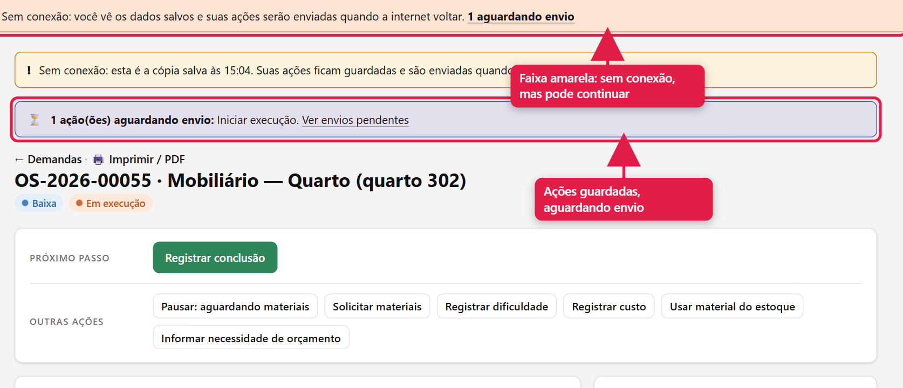

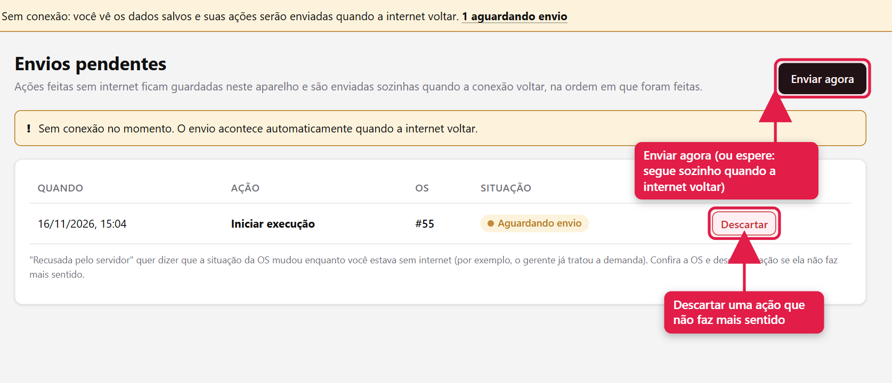

---

## 8. Notificações e app instalável

| Situação | Explicação e solução |
| --- | --- |
| Não chegam notificações no celular | Em **Notificações**, tocar em **Ativar notificações neste aparelho** e **permitir** no navegador. Conferir se o celular não está em modo "Não perturbe" |
| iPhone: não aparece "Instalar" | No iPhone, abrir no **Safari**, tocar em **Compartilhar → Adicionar à Tela de Início**. As notificações só funcionam com o app instalado (iOS 16.4 ou mais novo) |
| Android: instalar | No Chrome ou Brave: botão **Instalar** no topo ou menu do navegador → **Instalar aplicativo** |
| Brave: "Registration failed" ao ativar notificações | O Brave desativa o serviço de mensagens do Google. Ativar em `brave://settings/privacy` → "Usar serviços do Google para mensagens push", ou usar o Chrome |
| Não chega aviso durante a noite | Há **horário de silêncio** (22h às 7h), exceto emergências, que sempre chegam |
| Notificações bloqueadas | Cadeado ao lado do endereço → Notificações → Permitir |
| Aparece "Nova versão disponível" | Tocar em atualizar. O app também se atualiza sozinho ao ser aberto com internet |
| O app parece desatualizado | Fechar totalmente e abrir de novo, com internet |

Os avisos dentro do sistema (sino em **Notificações**) chegam a todos; o push no celular segue regras por perfil (por exemplo, o técnico recebe designações, correções e prazos).

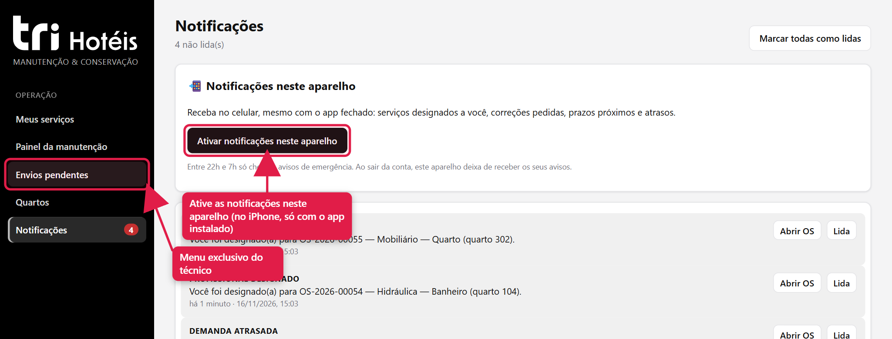

---

## 9. Cadastros e administração

**Usuários**
- Login: 3 a 30 caracteres, só minúsculas, números, ponto, hífen e sublinhado. Não há e-mail.
- Gerente cria: governanta, técnico e outros gerentes **do próprio hotel**. Diretoria e administrador só o administrador cria.
- **Excluir:** se a pessoa já participou de demandas ou inspeções, o nome continua no histórico (a conta é arquivada). Se for **responsável por demandas em aberto**, o sistema bloqueia: designar outro técnico antes.
- Não existem os perfis "chefe de manutenção" e "aprovador financeiro": o gerente distribui as demandas, e orçamentos acima do limite vão para a diretoria ou administração.

**Quartos**
- **Importar do HITS:** Cadastros → Importar quartos → escolher a planilha (.xlsx ou .csv) → **conferir a prévia** → Aplicar. Quartos provisórios sem histórico são removidos; os com histórico viram "PROV-n" para revisão; quartos reais fora da planilha **não** são apagados (aparecem no relatório).
- Hotel que "não casa": o nome na planilha precisa corresponder ao hotel cadastrado (maiúsculas e acentos são ignorados).

**Hotéis**
- **Validação do gerente**, **Gerente aprova até (R$)**, **Orçamento mensal** e **Relato pelo QR** ficam em Cadastros (administrador).

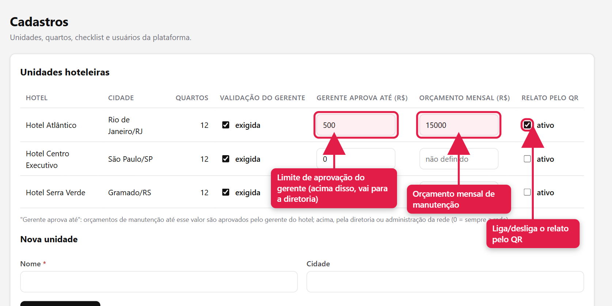

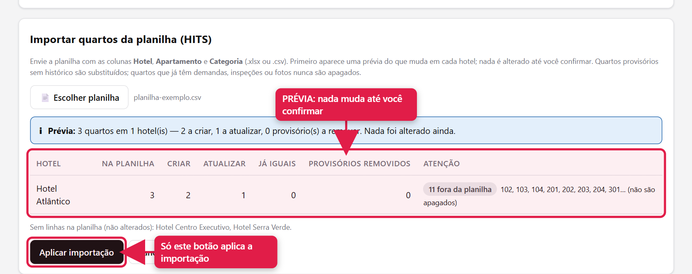

**Obrigações legais**
- "Criar lista padrão" cadastra PMOC, caixa d'água, extintores, AVCB, dedetização, elevadores, gerador, caixa de gordura e SPDA, **sem data**. Depois informar a última realização de cada uma. As periodicidades são sugestões: confirmar com o engenheiro responsável.
- Obrigação que o hotel não tem (ex.: elevador): **Editar → desmarcar "Acompanhar"**.
- Aviso 30 e 7 dias antes; quando vence, a diretoria também é avisada.

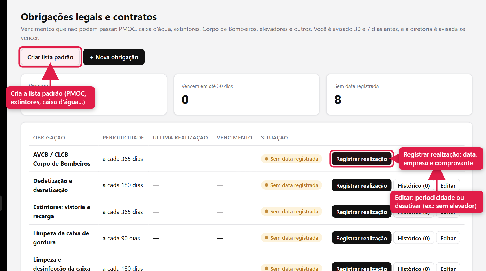

**Estoque e preventiva**
- A baixa de material é feita **dentro da OS**, pelo técnico ("Usar material do estoque"). Saldo abaixo do mínimo gera aviso "repor".
- A preventiva só cria uma nova OS quando a anterior do mesmo plano foi encerrada.

---

## 10. Para a equipe de TI

**Ambiente**
- Node.js 22.13 ou mais novo, sem dependências externas, banco SQLite em arquivo.
- Variáveis (arquivo `.env`, modelo em `.env.example`): `NODE_ENV=production`, `DATA_DIR` (pasta de dados **fora** da pasta do app), `PORT`, `TRUST_PROXY=1`, `COOKIE_SECURE=1`, `VAPID_SUBJECT`.
- Hospedagem: Hostinger (Node.js). Publicação automática do ramo `main` do GitHub.
- Fluxo seguro: enviar para o ramo `desenvolvimento`; o GitHub roda os testes e, se passarem, publica no `main`.

**Verificar a saúde**
- `https://…/healthz` responde **200** quando está tudo bem e **503** se o banco falhar ou se o último backup tiver mais de 48 horas. Cadastre esse endereço em um monitor (ex.: UptimeRobot).
- Se o backup diário falhar, os administradores recebem um aviso no sistema (uma vez por dia).

**Dados e backups**
- O banco e as fotos ficam em `DATA_DIR` (`hotelaria.db` e a pasta `uploads`).
- Backup automático do banco: 1 por dia, últimos 30; manuais: últimos 5. O administrador gera e baixa em **Backups**.
- As **fotos** não entram no backup diário do banco: dependem do backup da hospedagem.
- **Restaurar:** parar o aplicativo → substituir `hotelaria.db` pelo backup escolhido (apagar `hotelaria.db-wal` e `hotelaria.db-shm`) → iniciar. Fazer cópia do arquivo atual antes.

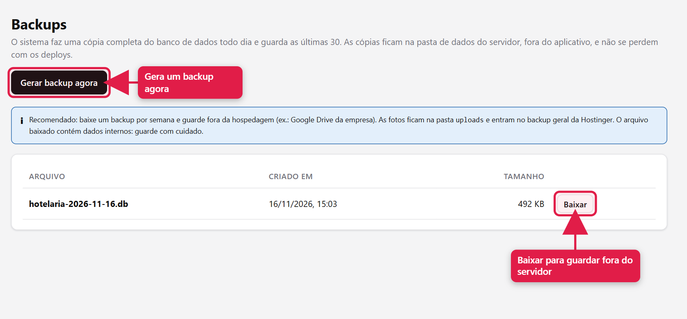

**Investigar**
- **Registro de ações** (aba Ações): quem alterou o quê. Aba **Acessos**: entradas, saídas, tentativas erradas e bloqueios (guardados 180 dias).
- O limite de tentativas de login por IP fica na memória do servidor: reiniciar o aplicativo libera todos os endereços bloqueados.

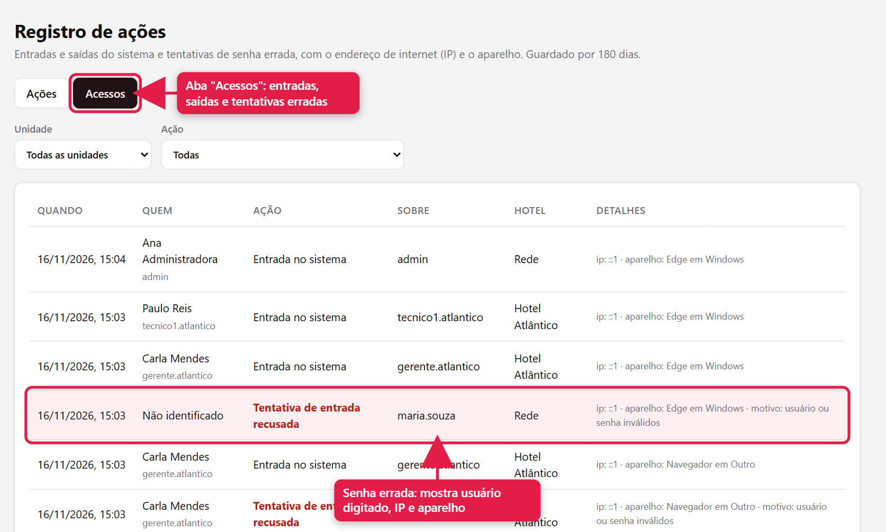
- Após atualização do sistema, o banco se ajusta sozinho ao iniciar (migrações automáticas).
- Testes automáticos: `npm test` (devem passar todos antes de publicar).

**Segurança**
- Senhas nunca são gravadas em texto, e o registro de acessos não guarda senha digitada.
- Credenciais iniciais ficam em arquivos `credenciais-*.txt` em `DATA_DIR`: entregar e **apagar**.

---

## 11. Mensagens que o usuário pode ver

| Mensagem | O que significa | Ação |
| --- | --- | --- |
| Usuário ou senha inválidos. | Dados de login incorretos, ou conta desativada | Seção 3 |
| Muitas tentativas de login. Aguarde 15 minutos. | Bloqueio temporário do endereço | Aguardar |
| Sessão expirada. Faça login novamente. | Passaram 12 h ou a sessão foi encerrada | Entrar de novo |
| Defina uma nova senha para continuar. | Senha provisória | Trocar a senha |
| Informe o código de verificação. / Código de verificação incorreto. | Conta com duas etapas | Seção 3 |
| Sem permissão para acessar esta unidade. | Tentou ver dados de outro hotel | Normal para o perfil |
| Seu perfil não tem permissão para esta ação. | Ação de outro perfil | Pedir a quem tem permissão |
| Ação "…" não permitida para seu perfil no status atual. | A situação da demanda mudou | Atualizar e conferir |
| Anexe ao menos uma fotografia do serviço concluído... | Falta a foto obrigatória | Anexar foto "Após a conclusão" |
| O checklist deste hotel está vazio... | Sem itens ativos | Seção 6 |
| Este usuário é responsável por N demanda(s) em aberto... | Não dá para excluir | Designar outro técnico |
| Sem conexão com a internet. Tente novamente quando a rede voltar. | Sem internet (perfis que não têm modo offline) | Aguardar a conexão |
| Muitos relatos enviados deste aparelho / Já recebemos vários relatos deste quarto hoje | Limites do relato por QR | Aguardar; urgência: ligar para a recepção |
| Erro interno do servidor. | Falha do sistema | Anotar hora e o que fazia; acionar o nível 3 |

---

## 12. Escalonamento

Preencha com os contatos da sua rede.

| Nível | Nome | Telefone / WhatsApp | Horário |
| --- | --- | --- | --- |
| 1: Gerente do hotel | | | |
| 2: Administrador do sistema | | | |
| 3: TI / servidor | | | |

**Ao escalar, envie:** usuário e hotel, perfil, aparelho e navegador, mensagem exata (print), passo a passo, horário e o que já foi tentado.

---

## 13. Glossário

| Termo | Significado |
| --- | --- |
| OS | Ordem de serviço: cada problema de manutenção registrado |
| Alçada | Valor até o qual o gerente aprova orçamentos sozinho |
| Preventiva | Manutenção programada, que gera OS sozinha |
| PMOC | Plano de manutenção, operação e controle do ar-condicionado |
| AVCB | Auto de vistoria do Corpo de Bombeiros |
| HITS | Sistema de gestão hoteleira (PMS) de onde vêm os números dos quartos |
| PWA / app instalável | O sistema instalado na tela inicial do celular, que abre como um aplicativo |
| Duas etapas (2FA) | Código extra, de um aplicativo no celular, pedido junto com a senha |
